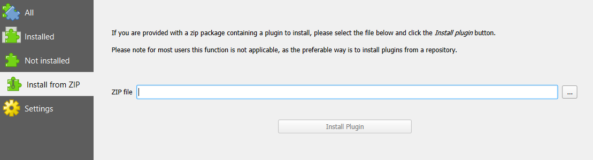
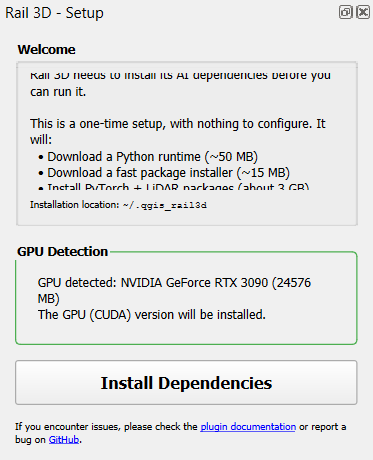
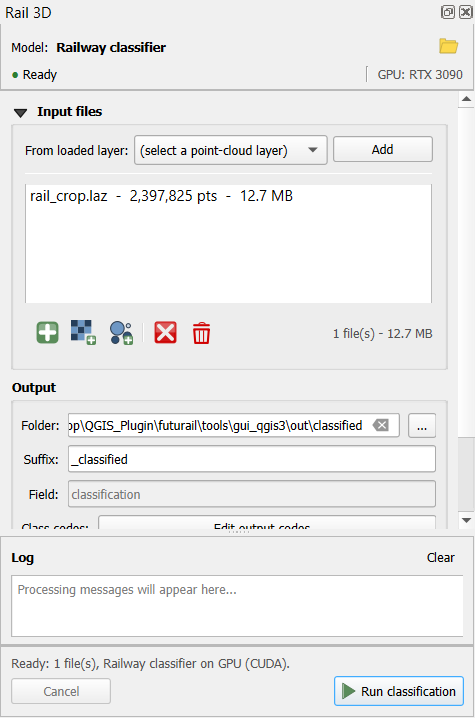
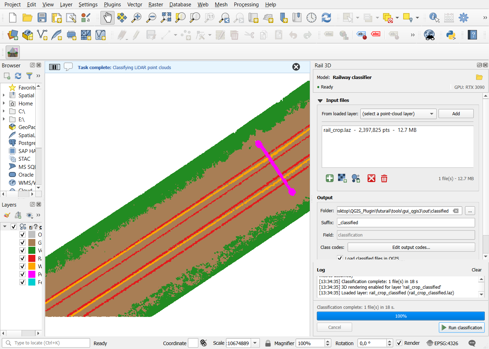
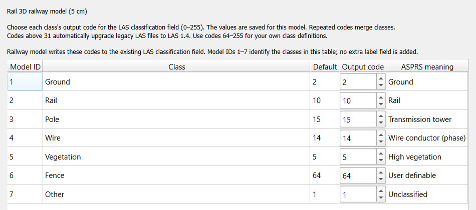

# Rail 3D for QGIS

Rail 3D classifies railway LiDAR point clouds. You give it a LAS or LAZ file,
it writes back the same file with every point labelled: ground, rail, pole,
wire, vegetation, fence or other. It runs inside QGIS, the free GIS desktop
application, on a Windows PC with an NVIDIA graphics card.

Time needed the first time: about 30 minutes, most of it waiting for
downloads. After that, classifying a file takes minutes.

## 1. Check the computer

| Needed | Why |
|--------|-----|
| Windows 10 or 11 | The steps below are written for Windows (Linux works too). |
| NVIDIA graphics card (GeForce RTX or Quadro / RTX A series), 8 GB of memory or more | The model runs on the GPU only. Without an NVIDIA card the plugin installs but cannot classify. |
| Recent NVIDIA driver | Open the **NVIDIA app** or **GeForce Experience** and update, or download the driver from https://www.nvidia.com/drivers. |
| 10 GB of free disk space | QGIS (1 GB), the plugin's own Python environment (about 5 GB) and your results. |
| Internet connection | QGIS download (1 GB) and the one-time setup (about 3 GB). |

To check the graphics card: right-click the desktop, **NVIDIA Control Panel**
(or open the **Task Manager**, tab **Performance**, entry **GPU**). The name
must start with NVIDIA.

## 2. Install QGIS

1. Go to https://qgis.org/download/ and download the Windows installer of the
   **Long Term Version** (QGIS 3.44 or newer; any newer version works too).
2. Run the installer. Keep every default and click **Next** until it finishes.
3. Start QGIS from the Start menu (**QGIS 3.44** folder, **QGIS Desktop**).

## 3. Download Rail 3D

1. Open the **Releases** page of this repository:
   https://github.com/akharroubi/futurail3d/releases
2. Download the file **Rail_3D_v1.0.0.zip**. Leave it as a ZIP file, do not
   unzip it.

## 4. Install the plugin in QGIS

1. In QGIS, open the menu **Plugins ▸ Manage and Install Plugins...**
2. Click **Install from ZIP** in the list on the left.
3. Click the **...** button, choose the downloaded `Rail_3D_v1.0.0.zip`, then
   click **Install Plugin**.
4. Close the window. A **Rail 3D** button (railway icon) is now in the
   toolbar, and a **Plugins ▸ Rail 3D** menu exists.

## 5. First start: one-time setup

1. Click the **Rail 3D** toolbar button. A **Rail 3D - Setup** panel opens
   on the right. It shows the graphics card it found.
2. Click **Install Dependencies**. The plugin downloads its own Python and
   the deep-learning libraries into a private folder of your user account
   (nothing else on the computer is changed, no administrator rights
   needed). This takes 5 to 15 minutes depending on the connection. QGIS
   stays usable meanwhile.
3. When the bar reaches 100 percent, the Setup panel closes by itself and the
   **Rail 3D** panel opens.

If the panel says **No NVIDIA GPU detected**, install the NVIDIA driver
(section 1), restart the computer and click the button again.

## 6. Classify a file

1. In the **Rail 3D** panel, click **Add files...** and choose one or more
   LAS or LAZ files. Or drag the files from the Explorer into the list.
2. **Output ▸ Folder**: where the classified copies go. It is filled with the
   folder of the first file; change it if you want. The copies are named
   `<file>_classified.laz` (or `.las`), the originals are never modified.
3. Click **Run classification**. The bar at the bottom shows the progress
   and the panel log shows what happens. A file of 20 million points takes
   a few minutes on an RTX 3090.
4. When it finishes, the classified file is added to the map, coloured by
   class. The message bar at the top offers **Open folder**.

To look at it in 3D: menu **View ▸ 3D Map Views ▸ New 3D Map View**, then
hold the middle mouse button (or Shift and the left button) and move the
mouse to tilt the view.

## 7. The classes

| Class | Code written in the file | Colour in QGIS |
|-------|--------------------------|----------------|
| Ground (track bed, platforms) | 2 | brown |
| Rail | 10 | red |
| Pole (catenary masts, portals, supports) | 15 | magenta |
| Wire | 14 | orange |
| Vegetation | 5 | green |
| Fence | 64 | turquoise |
| Other | 1 | grey |

The codes follow the LAS standard (ASPRS) where a class exists there. To use
other codes, click **Edit output codes...** in the panel before running: each
class gets the number you type; two classes with the same number are merged.

The model uses only the point positions: intensity, colour or return number
are not needed. It expects dense data (about 100 points per square metre or
more, typical of mobile mapping or low-altitude flights) in metres or feet
with a coordinate system in the file; the plugin converts feet by itself.

## 8. Large files

For files above about 20 million points, open **Advanced parameters** in the
panel and tick **Tile large files**. The file is then classified piece by
piece, and streamed from disk if it does not fit in memory. Everything else
stays automatic.

## 9. If something goes wrong

| What you see | What to do |
|--------------|-----------|
| The Setup panel reports an error | Click **Reinstall Dependencies**. If it fails again, close QGIS, open it again and use **Plugins ▸ Rail 3D ▸ Repair dependencies**. |
| "Needs an NVIDIA GPU", "No GPU visible" | Install or update the NVIDIA driver, restart the computer. |
| "Model libraries missing" | **Plugins ▸ Rail 3D ▸ Repair dependencies**, then restart QGIS. |
| The run stops with "out of memory" | Close other programs that use the graphics card (games, video tools), run again. For very large files tick **Tile large files**. |
| The result is not visible | Right-click the layer in the **Layers** panel (left), **Zoom to Layer**. |
| Anything else | Copy the text of the panel log (bottom of the Rail 3D panel) and send it with your question. |

Contact: Abderrazzaq Kharroubi, akharroubi2@gmail.com.

## What is in this repository

- `Rail3D/`: the plugin source. The installable ZIP is built from it with
  `python build_zip.py` and published on the Releases page.
- `tools/`: the scripts used to verify the delivery (headless setup, real
  QGIS window run, screenshots).

Plugin code: GPL-3.0-or-later. Model weights: © 2026 Abderrazzaq Kharroubi,
GeoScITY Lab, University of Liège; provided to Futurail for evaluation, not
for redistribution.
