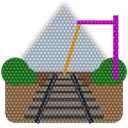

# Rail 3D

QGIS plugin that classifies railway corridor LiDAR point clouds (LAS / LAZ /
COPC) with a deep-learning model. Every point gets one of seven classes,
written to the LAS classification field:

| Class | Default code | Meaning |
|-------|--------------|---------|
| Ground (track bed, platforms) | 2 | ASPRS Ground |
| Rail | 10 | ASPRS Rail |
| Pole (catenary masts, portals, supports) | 15 | ASPRS Transmission tower |
| Wire | 14 | ASPRS Wire conductor |
| Vegetation | 5 | ASPRS High vegetation |
| Fence | 64 | first user-definable code |
| Other | 1 | ASPRS Unclassified |

Every code is editable in the dock (Output > Class codes) and in Processing
(`OUTPUT_CODES_JSON`). Two classes given the same code are merged.

## Requirements

- Windows 10 / 11 or Linux, QGIS 3.34 or newer (QGIS 4 included).
- An NVIDIA GPU with a current driver. 8 GB of GPU memory or more is
  recommended; the plugin adapts to smaller cards.
- About 5 GB of free disk space for the Python environment, and an
  internet connection for the first setup.

The model works from the point coordinates only (XYZ): intensity, colour or
return numbers are not needed. Files in feet are converted from their CRS
before inference. Point clouds with 100 points per square metre or more give
the best results.

## Install and first run

See the step-by-step guide in the repository:
https://github.com/akharroubi/futurail3d

## Processing

The algorithm `rail3d:classify_point_cloud` is available in the Processing
Toolbox, the Graphical Modeler and the `qgis_process` command line. Its help
panel lists every parameter.

## Licence

Plugin code: GPL-3.0-or-later (LICENSE). Model weights: © 2026 Abderrazzaq
Kharroubi, GeoScITY Lab, University of Liège; evaluation copy, not for
redistribution. Third-party notices: THIRD_PARTY_NOTICES.md.
